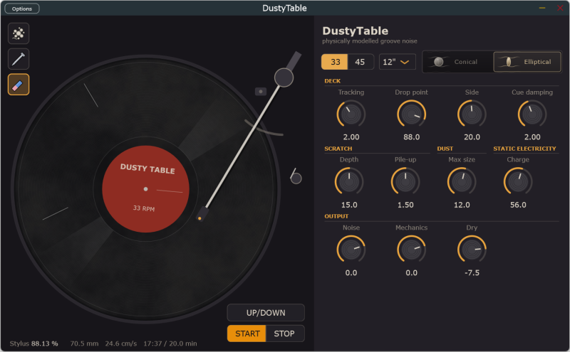

日本語 | [English](README.en.md)

# DustyTable

レコード盤のノイズを物理モデリングで生成するオーディオプラグイン(VST3 / Standalone、JUCE 8)。溝を針がトレースする音を計算し、入力音に加算します。



## 特長

- **原音の音質を変えずに、ノイズだけを加えます** 入力音には EQ・サチュレーション・ワウフラッターなどの色付けを一切しません(変わるのは Dry のゲインと、針が溝から離れている間のミュートだけ。キズで針が跳ねた瞬間は、物理モデルどおり原音がわずかに沈みます)。音作りは、好きなコンプレッサー・EQ・サチュレーターで自由に行えます。
- **サンプルではなく物理モデル** ホコリの「プチプチ」、キズの「ボツッ」、静電気の「チリチリ」を、針先と溝壁の接触・カンチレバー・トーンアーム・MMカートリッジ・RIAAの計算から生成します。同じパターンの繰り返しにはなりません。
- **盤面を自分で汚せる** ホコリ・釘・消しゴムのツールで、回っている盤面に直接ホコリを積もらせたり、好きな位置にキズを付けたり消したりできます。キズはプロジェクトに保存され、DAWの同じ箇所を再生すれば同じタイミングで鳴ります。
- **ターンテーブルの操作音まで再現** START/STOP、アームの上げ下げ、モーターやギア、アームレストの音を、部品の寸法と素材から物理モデルで鳴らします。カートリッジのノイズ(Noise)と空気中の機械音(Mechanics)は別々に音量を調整できます。
- **プレーヤーの設定を選べる** 33/45回転、盤サイズ(12"/10"/7")、針(Conical/Elliptical)、針圧などで音が変わります。針は再生とともに内周へ進み、面の終わりでアームが自動で戻ります。

## インストール

[GitHub の Releases](../../releases) から最新版をダウンロードしてください。配布しているのは Windows(64-bit)版です。

1. `DustyTable-<バージョン>-Windows-x64.zip` を展開します。
2. VST3 プラグイン:`VST3` フォルダの中の `DustyTable.vst3`(フォルダごと)を `C:\Program Files\Common Files\VST3` にコピーします(管理者権限が必要です)。DAW でプラグインを再スキャンすると、エフェクトとして使えるようになります。
3. Standalone:`Standalone` フォルダの `DustyTable.exe` は、好きな場所に置いてそのまま起動できます(オーディオ入出力は設定画面で選びます)。

実行ファイルにはコード署名をしていないため、初回起動時に Windows SmartScreen の警告が出ることがあります。その場合は「詳細情報」→「実行」を選んでください。

## 使い方

1. トラックにエフェクトとして挿入します(原音にノイズが加わります)。
2. START ボタンでターンテーブルが回り始め、アームが Drop point の位置に下ります。STOP でアームがアームレストに戻ります。
3. 盤面の左上のツールでホコリやキズを付け、DUST・SCRATCH・STATIC ELECTRICITY のつまみで質感を調整します。
4. OUTPUT の Noise・Mechanics・Dry で、ノイズ・機械音・原音のバランスを決めます。

アームの上げ下げは「Start / Stop」パラメータ(オートメーション可、GUIのSTART・STOPボタン)で動作し、DAWの再生・停止とは連動しません。オートマチック式のプレーヤーを想定しています。DAWプロジェクトを開いたときは、操作を再生せず、保存されたアームの状態から始めます。

- **針の進行** 針は溝に乗っている間、盤の回転に合わせて少しずつ内側へ進みます(Side の長さで録音帯の外周から内周まで。ホストの再生・停止とは関係なく、針が溝に乗って盤が回っている間だけ進む)。録音帯の終わりに達すると自動でSTOPと同じ動作をし、Start/Stop パラメータもStopに切り替わります。アームがアームレストに戻ると、次のSTARTでは Drop point の位置に下ります。現在の針の位置は盤面の下に「Stylus 〇〇 %」と表示します。プロジェクトを保存すると針の位置も保存され、アームが盤の上にある状態なら、開いたときにその位置から再開します。盤の角度は、定速で回っている間はホストの再生位置から決めるので、同じ箇所を再生すればキズも同じタイミングで鳴ります(ただし、針の位置は再生位置では戻りません)。ホストが停止中も盤は回り続けます。
- **その場でのアームの上げ下げ(UP/DOWN)** START/STOP の上の UP/DOWN ボタンを押すたびに、アームをその場で上げる/下ろすを切り替えます。ボタン自体は状態を持たず、上がっているかどうかはアームの機構が覚えています(オートメーションの対象外)。上げるのは2つ目の小さなモーターが回すキュー用のカムで、同じリフターの棒を押し上げます(約1秒で上がる)。下ろすときは Cue damping の速さで下り、最後は自重で接地します。アームが上がっている間は、3つ目のモーターがウォームギアとすべりクラッチでアームを回し、Drop point の位置まで約8mm/秒でゆっくり動かします(上げている間に Drop point を動かすと、その位置まで動く。再生中に Drop point を動かした場合は、UPで上がりきってから動く)。下ろすとその位置から再生が続きます。移動中に DOWN を押すと、その場で止まって下ります。アームがアームレストにある間は何も起きません。STARTのあと、アームが下りている途中で押した場合は、下りきってから上がります。上げたまま STOP を押すと、今までどおりアームレストに戻ります。上げている間も盤は回り続け、針の位置は進みません。アームを上げた状態とその位置はプロジェクトに保存され、開いたときにその状態から始まります。キュー用と移動用のモーター、ギア、リミットスイッチの音も物理モデルで鳴ります。
- **ターンテーブルの回転** STARTで回り始め(約0.8秒で定速。アームが動き出す1秒の待ちの間に定速になる)、STOPでアームがアームレストに戻ってカムが止まると、約2.5秒かけて止まります。止まっていた分だけ盤の角度は再生位置からずれ、以後はそのずれを保ったまま再生位置に従います。

## パラメータ

| セクション | パラメータ |
|---|---|
| Deck | 33/45、盤サイズ(12"/10"/7")、針(Conical/Elliptical。溝を上から見た針先の形のイラスト付きスイッチで選ぶ:丸い接触面が Conical、細長い接触面が Elliptical)、針圧(g)、Drop point(STARTでアームが下りる位置、%。パラメータIDは従来どおり position。動かしている間は、その位置に半透明のアームと着地する溝の円を表示し、つまみを離すと消える。ホイールやオートメーションで変わったときは、約0.8秒変化がなければ消える)、Side(片面の長さ、分)、Cue damping(オイルダンパーによるリフターの下降時間、秒)、Start / Stop(START・STOPボタン。パラメータIDは従来どおり arm) |
| Dust | Max size(µm)。量(Dust Density、溝1mあたりの個数)はGUIでは盤面のツールで操作する(ホストからはパラメータとして見え、オートメーションもできる) |
| Scratch | Depth(µm)、Pile-up(盛り上がりの半幅、mm。大きいほど低音が増えるが、約1.5mmを超えると頭打ち)。どちらも全部のキズに効く |
| Static Electricity | Charge |
| Output | Noise(カートリッジ出力のゲイン)、Mechanics(空気中の機械音のゲイン)、Dry(原音、最小でOff) |

## 盤面のツール

盤面の左上のアイコンでツールを選ぶ(選んでいるアイコンをもう一度押すと解除)。

- **ホコリ** 盤面を押している間、ホコリが増える。押した位置に関係なく盤面全体に広がり、押した時間の合計が約5秒で最大(60/m)になる。量は盤面が黒からまだらなグレーになることで表示する(まだら模様は見た目だけで、音は全体に均一なホコリとして計算する)。
- **釘** 押して離すと、離した位置にキズができる。キズは直線で、向きは放射方向から少し傾く(毎回ランダム)。長さは押していた時間で決まり、最短は約2mm、約2秒で最大(録音帯の幅の2/3)。押している間は、できるキズをオレンジ色で予告表示する。盤の外で離すとキズはできない。キズは最大32本で、それを超えると一番古いキズから消える。
- **消しゴム** 消しゴムを盤面に重ねると、クリックで消えるキズがオレンジ色で表示される。対象は、ポインタから約12px以内を直近0.4秒のうちに通ったキズのうち、最後に通ったもの。盤が回っていても、キズがポインタの下を通った直後にクリックすれば消せる(止まっていれば一番近いキズ)。対象のキズがない盤面をクリックするとホコリが最大量の約5%減り、押し続けると(0.3秒以降)ホコリツールと同じ速さで減り続ける。

ツールは画面に描かれている盤の角度で働くので、盤が回っていても止まっていても、見えている位置にキズを付けたり消したりできる。

キズは録音帯の中での相対位置で保存するので、盤サイズを変えても同じ配置のまま付いている。キズはプロジェクトの状態に保存する(オートメーションの対象外)。
以前の Count / Length / Layout で作ったキズは、古いプロジェクトを開いたときに同じ配置のキズとして取り込まれる。

## モデル

溝の形状 → 針先の幾何 → 針の力学 → MMカートリッジ → RIAA、の順に計算します。力学系は約350kHzにオーバーサンプリングして計算しています。

- **溝の線速度** v = 2πr·rpm/60。33回転(内部は33⅓で計算)/45回転、盤サイズ、針位置(外周→内周)で変わり、クリックの長さや発生頻度はここから決まります。
- **溝壁** 45/45方式に従って左右の壁を独立に扱います。右chは極性を反転するので、横振動がL+R、縦振動がL−Rになります。
- **針** 先端質量をヘルツ接触(F = Kδ^1.5、片側だけ押し返す)で壁に押し付けます。カンチレバーのばね(コンプライアンス20µm/mN)の先にトーンアーム(12g、約10Hz共振)がつながっています。出力はアームに対する針先の相対速度です。
- **ホコリ(プチプチ)** 溝の長さあたりのポアソン過程で発生します。粒径はパレート分布。片方の壁に乗ることが多く、針先が球を乗り越えるときの軌跡を変位として与えます。
- **キズ(ボツッ)** 盤上の決まった角度にある溝で、1回転ごとに鳴ります。削れた溝の縁の角と盛り上がり(バリ)で「ツ」の成分が出ます。「ボ」の成分は、削られて押しのけられた盤材の盛り上がり(Pile-up、幅は数mm、高さは深さの5〜10割)から出ます。盛り上がりが針をゆっくり持ち上げると、アーム共振(約10Hz)より速いのでアームは追従できず、カートリッジの出力になります。さらにRIAAで低域が持ち上がります。キズには半径方向の範囲があり、針位置が進むと現れたり消えたりします。
- **静電気 Static Electricity(チリチリ)** 回転による摩擦で帯電します。帯電量に応じて雪崩的な放電が始まり、小さな放電が密に続いて電荷の一部が抜けると止まり、また帯電します。放電パルスはカートリッジのインダクタンスと負荷容量の共振(約16kHz、Q=3)で鳴ります。帯電するとホコリも引き寄せます。
- **アームの上げ下げ** アームレストのクランプは手で操作し、そのあとSTART/STOPボタンを押します。リフターとアームの移動は、1つのモーターが一方向にだけ回すカムで行います。
  - ボタン:指先(柔らかいばねとダンパー)がキーを押し込みます。タクトスイッチのドームは押し込むと力のピークを越えて座屈し、キーが底に当たって「カチッ」と鳴ります。指を離すと、ドームが戻ってキーが上の縁に当たります。キーはフロントパネルと一体成形の舌片です。
  - モーター:小型DCモーターを1.5Vで駆動します。電気(抵抗・インダクタンス・逆起電力)と機械(慣性・ギアの摩擦)の方程式を解きます。ウォームギア(1:30)と平歯車(8:88)でカムを回します。カム1回転でダウンとアップを1回ずつ行い、半回転は約3.2秒です。起動するときの回転上昇も、停止するときの減速もこの方程式の結果です。
  - カム:半回転ごとに「リフターを上げる → アームを振る → リフターを下げる」を行います。前半がダウン、後半がアップです。リミットスイッチの板ばねがカムの切り欠きに落ちるとモーターが止まります。ボタンはスイッチを短絡してモーターを回し、板ばねが切り欠きから出ると回り続けます。途中で逆の操作をすると、カムは戻らずに次の停止位置まで回ります。
  - リフター:リフターの棒は、ばねで押し付けられた従動レバーに乗っています。レバーはカムのゆるい斜面で持ち上がり、下げるときは段差から落ちてカムに当たり、弾みます(「コトッ」)。棒はレバーから離れて、オイルダンパーの速度(Cue damping)でゆっくり下がります。ただしダンパーのピストンが効くのは筒の中だけで、盤面の手前0.6〜1mm(毎回少し違う)からは棒が自由に落ちます。アームは最後のこの距離を自重で落ちて針が溝に当たり、カートリッジから低く大きい「ボツッ」が出ます(アームの約10Hzの共振とRIAAの低域強調)。
  - アームの移動:カムはすべりクラッチを介してアームを振ります。戻りではカムがアームレストのストッパーより少し先まで回るので、アームはその手前の速度でストッパーに当たり、クラッチに押されながら数回弾んで止まります(「カツン」)。
  - ダウン:クランプを外す → STARTを押す → 1秒待つ(プラッターの回転が上がるのを待つ) → モーターが回る(リフターを上げる → 盤上へ移動 → レバーが落ちる) → ダンパーでゆっくり下降 → 最後の1mm弱を落ちて接地(「ボツッ」)
  - アップ:STOPを押す → モーターが回る(リフターを上げる → 離脱 → アームレストのストッパーに当たる → レバーが落ちる) → アームレストに乗る → クランプを閉める
  - アームは自重(針圧)を持ち、リフターのシリコンパッドやアームレストのゴム台が下から片側だけで支えます。接地(アームの重さが針に移っていく「ポスッ」)と離脱は、この力学がそのままカートリッジの出力になります。
  - 原音(入力音)は、溝にかかっている針圧の割合に応じて鳴ります。針が盤面に触れていない間は無音です。ホコリ・キズ・静電気も鳴りません。
- **空気中の機械音(Mechanics)** ボタン、モーターとギア、カムの従動レバー、リミットスイッチ、リフター、アームレストの音で、カートリッジを通りません。RIAAも通りません。
  - 力の源
    - クランプがアームやゴムのストッパーに当たる衝突力(ヘルツ接触+減衰)
    - ボタン:指の力、ドームの反力、キーが底と上の縁に当たる力
    - 従動レバーとカムの接触力(カム表面の微小な凹凸も含む)。段差から落ちる間はばねの力だけが残ります。
    - リミットスイッチの板ばねが切り欠きに落ちる・出るときの衝突(落ちる側はエラストマーの先端で柔らかく当たる)
    - アームがアームレストのストッパーに当たる衝突力(クラッチの押し付け力を含む)
    - エンジンで計算したリフター・アームレストとアームの接触力
    - モーターの反トルク(コミュテータの脈動とブラシの摩擦を含む)とロータのアンバランス
    - ギアの歯が噛み合うたびに変わる歯の荷重。成形品なので、歯ごとに誤差が違います。
  - 鳴らす部品:アルミのアームパイプ、ばね鋼のクランプ、鋼の支柱、モーターのケース、ギアボックスのカバー、ボタンのキー、フロントパネル、リミットスイッチの板ばね、POMの従動レバー、MDFのキャビネット(15mm)
    - 固有周波数は、はり・板・円筒殻の理論で寸法と素材から計算しています。板は加振点でのモード形状の大きさも考慮しています(節の近くで加振したモードはほとんど鳴りません)。
    - アームパイプ(ヘッドシェルとカートリッジ15g)、クランプのフック、支柱の上のリフターバーやアームレスト、ボタンのキャップ、レバーの先は、先端の質量として計算に含めています。
  - 力の伝わり方:支柱は共振周波数より下では剛体として働くので、接触力はそのままキャビネットに伝わります。モーターはゴムブッシュで固定しているので、ブッシュの共振より上の振動はキャビネットに伝わりにくくなります。
  - 部品の寸法に対して波長が長いと音になりにくい効果(放射効率)と、聴取距離(0.7m)の減衰も入れています。
  - 音の高さ・強さのバランスは、実機(ベルトドライブのオートマチック機)の動画を分析して、各音のスペクトルと相対的な音量が近くなるように部品の寸法・素材・速度を選んでいます。
  - 毎回同じ音にならないように、操作のたびに部品どうしが当たる位置や締まり具合が少し変わるとして、各部品の共振周波数(約±35セント)と加振の強さ(約±2dB)をばらつかせています。衝突の速度、ボタンのドームの硬さ、指の速さと押している時間、モーターの電圧(回転速度とギアの音の高さ)も毎回少し変わります。

## ビルド

```
cmake -S . -B build                      # JUCE 8.0.4 を FetchContent で取得
cmake -S . -B build -DDUSTYTABLE_JUCE_PATH=<JUCEのパス>   # ローカルのJUCEを使う場合
cmake --build build --config Release
```

成果物: `build/DustyTable_artefacts/Release/VST3/DustyTable.vst3`(および Standalone)。

Standalone のアプリアイコンは `Resources/icon_big.png`(1024px)と `Resources/icon_small.png`(16〜48px用に簡略化)で、ビルド時に実行ファイルへ埋め込まれます。デザインを変えるときは `python Tools/make_icon.py`(Pillow が必要)で描き直します。

`DustyTableRender [出力先] [秒数]` を実行すると、各ノイズ成分をWAVに書き出し、レベルを表示します(DAWなしで物理モデルの検証や較正ができます)。

`DustyTableUiCheck [出力先]` は、画面を出さずにエディタを作り、盤面のツールを順に操作して、各段階のスナップショット(PNG)とホコリ量・キズの本数を出力します。保存・読み込みと旧形式のプロジェクトの取り込み、針の切り替えスイッチも確認します。

### リリース

`v` で始まるタグを push すると、GitHub Actions(`.github/workflows/release.yml`)が Windows 版をビルドし、`DustyTableUiCheck` の確認に通れば、zip を GitHub の Release として公開します。タグは `CMakeLists.txt` の `project(DustyTable VERSION x.y.z)` と一致している必要があります(違うとビルド前に止まります)。

```
# CMakeLists.txt の VERSION を上げてコミットしたあとで
git tag v0.2.0
git push origin v0.2.0
```

Actions のタブから手動で実行すると、Release は作らずに zip をビルドして成果物(Artifacts)に置きます。

## ライセンス

このリポジトリのソースコード、ドキュメント、アイコンは [MIT License](LICENSE) です。

ただし、プラグインとアプリはビルド時に取得する [JUCE](https://juce.com) を組み込んでいます。JUCE 8 は AGPLv3 と商用ライセンス(JUCE 8 EULA)のデュアルライセンスで、JUCE 8.0.4 に同梱の VST3 SDK は GPLv3 と Steinberg の独自ライセンスのデュアルライセンスです。そのため、JUCE をオープンソースのライセンスで使ってビルドしたバイナリ(`DustyTable.vst3`、`DustyTable.exe`、`DustyTableUiCheck`)は、AGPLv3 の条件に従って配布してください(バイナリを配布する場合は、対応するソースコードを入手できるようにする必要があります)。

物理モデル(`Source/dsp`)と書き出しツール(`Tools/Render.cpp`、`DustyTableRender`)は JUCE を使っていないので、MIT License だけで利用できます。
